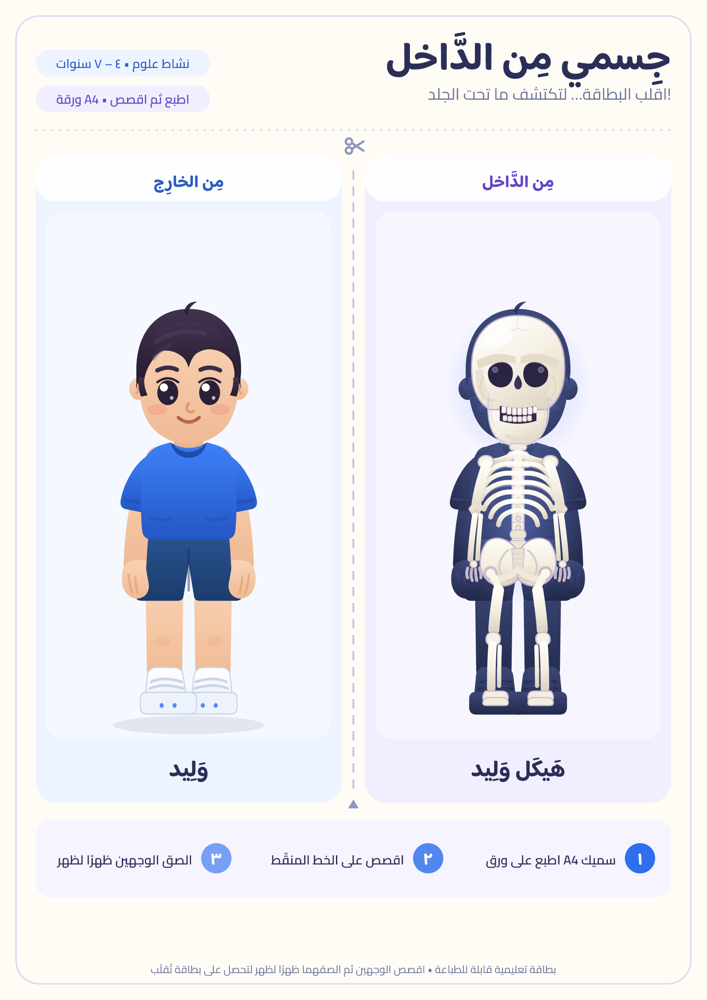

# جسمي من الداخل — بطاقة تعليمية قابلة للطباعة

إعادة تصميم لورقة نشاط «وليد / هيكل وليد»: بطاقة تُقلَب من الوجه الخارجي (الطفل)
إلى الوجه الداخلي (هيكله العظمي)، مرسومة بالكامل بصيغة **SVG متجهية** لطباعة نظيفة
بأي مقاس.



## المحتويات

| الملف | الوصف |
| --- | --- |
| `index.html` | صفحة تجريب تفاعلية: اقلب البطاقة بالضغط عليها + معاينة الصفحتين |
| `card-a4.svg` | صفحة ١ (A4): البطاقة بوجهيها + خط القص + خطوات التنفيذ |
| `activity-a4.svg` | صفحة ٢ (A4): ورقة نشاط — تسمية العظام، بنك كلمات، «هل تعلم؟» |
| `body-card-print.pdf` | الصفحتان جاهزتان للطباعة بحجم A4 (200dpi) |
| `assets/body-card.png` | معاينة PNG عالية الدقة لكل صفحة |
| `assets/boy.svg` | رسم «وليد» من الخارج |
| `assets/skeleton.svg` | رسم الهيكل العظمي داخل ظلّ الملابس |
| `assets/fonts/` | خطوط عربية مضمّنة (Baloo Bhaijaan 2 + Cairo، رخصة SIL OFL) |
| `src/build_sheet.py` | سكربت يعيد بناء صفحات A4 من ملفات SVG الأصلية |

## التشغيل

```bash
cd printables/body-card
python3 -m http.server 8000
# ثم افتح http://localhost:8000
```

أو افتح أي صفحة SVG مباشرة في المتصفح واطبعها (Ctrl/Cmd + P) بمقاس A4 وهامش «بلا».

### إعادة بناء الصفحات

```bash
# يحتاج: pip install resvg-py pillow  (اختياري: لتصدير PNG/PDF)
python3 src/build_sheet.py
```

`build_sheet.py` يبني `card-a4.svg` و`activity-a4.svg` من `assets/*.svg`.
تصدير PNG/PDF يتم عبر `resvg-py` لضمان ظهور الخطوط العربية.

## طريقة الطباعة

1. اطبع صفحة ١ على ورق A4 سميك (160–250 جرامًا) وبمقاس 100% دون «ملاءمة الصفحة».
2. اقصص الصفحة من الخط المنقّط في المنتصف (رمز المقص) لتصبح بطاقتين.
3. الصق الوجهين ظهرًا لظهر مع مطابقة الرسمين، أو اطوِ الورقة من المنتصف.
4. صفحة ٢ تُطبع كورقة نشاط مستقلة (ورقة لكل طفل).

## ملاحظات تصميمية

- **المطابقة التامة:** الهيكل مرسوم فوق «ظلّ» ملابس وليد نفسه (نفس المسارات)
  ليتعلّم الطفل أن العظام في المكان الصحيح تحت الجلد.
- **الخط:** Baloo Bhaijaan 2 للعناوين (خط عربي طفولي) و Cairo للنصوص، وكلاهما
  مضمّن في `assets/fonts` بصيغة WOFF2 مع Latin + Arabic في ملف واحد.
- **الألوان:** أزرق للوجه الخارجي، بنفسجي للوجه الداخلي، مع تباين كافٍ للطباعة
  بالأبيض والأسود (كل الرسم يعمل بدون ألوان).
- **النصوص:** مشكولة جزئيًا (جِسمي، الجُمجُمة، الحَوض…) لأن التشكيل يساعد
  الأطفال على القراءة الصحيحة.

## الترخيص

الرسوم والتصميم: مفتوحة للاستخدام التعليمي غير التجاري.
الخطوط: SIL Open Font License 1.1 — انظر `assets/fonts/LICENSE-*`.
